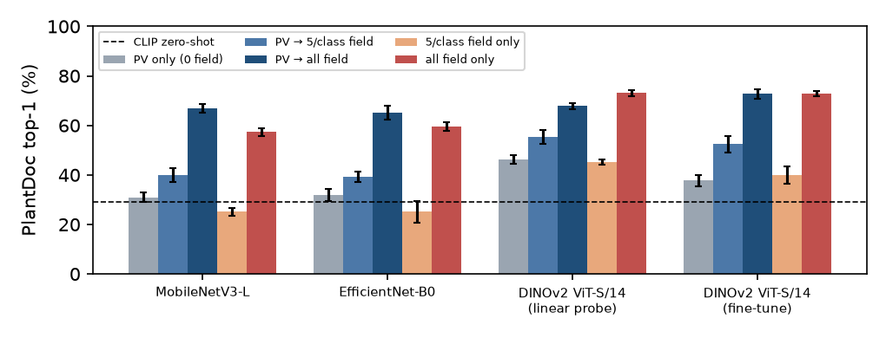
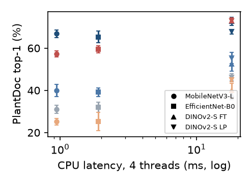

# Results summary (auto-generated by `scripts/summarize.py`; do not edit by hand)

Runs found: 67. Sum of per-run wall-clock: 1.84 GPU-hours (training + evaluation).

## Table 1: Trained on PlantVillage only (28 classes), mean ± std over 3 seeds

| Model | PV test top-1 | PlantDoc top-1 | PlantDoc dedup top-1 | PlantDoc macro-F1 | Gap (PV−PD) | ±95% CI half-width (bootstrap) |
|---|---|---|---|---|---|---|
| MobileNetV3-L | 98.9 ± 0.1 | 30.9 ± 1.9 | 31.1 ± 2.2 | 27.6 ± 0.6 | 67.9 ± 1.9 | 6.0 |
| EfficientNet-B0 | 99.4 ± 0.0 | 31.9 ± 2.4 | 32.5 ± 2.5 | 28.0 ± 1.2 | 67.5 ± 2.4 | 5.9 |
| DINOv2 ViT-S/14 (linear probe) | 97.6 ± 0.1 | 46.2 ± 1.7 | 46.6 ± 0.7 | 44.3 ± 2.0 | 51.4 ± 1.7 | 6.2 |
| DINOv2 ViT-S/14 (fine-tune) | 99.5 ± 0.1 | 37.7 ± 2.2 | 38.1 ± 1.8 | 36.1 ± 1.9 | 61.8 ± 2.3 | 6.3 |
| CLIP ViT-B/32 (zero-shot) | 25.2 | 29.2 | 28.7 | 24.6 | -4.0 | -- |

## Table 2: PlantDoc test top-1 vs. amount of field labels, mean ± std over 3 seeds

| Model | PV only (0 field) | PV → 5/class field | PV → all field | 5/class field only | all field only |
|---|---|---|---|---|---|
| MobileNetV3-L | 30.9 ± 1.9 | 40.0 ± 2.9 | 66.8 ± 1.8 | 25.1 ± 1.6 | 57.3 ± 1.5 |
| EfficientNet-B0 | 31.9 ± 2.4 | 39.1 ± 2.1 | 65.3 ± 2.8 | 25.1 ± 4.3 | 59.5 ± 1.8 |
| DINOv2 ViT-S/14 (linear probe) | 46.2 ± 1.7 | 55.4 ± 2.7 | 67.8 ± 1.1 | 45.1 ± 1.1 | 73.0 ± 1.4 |
| DINOv2 ViT-S/14 (fine-tune) | 37.7 ± 2.2 | 52.4 ± 3.3 | 72.7 ± 2.0 | 39.8 ± 3.5 | 72.9 ± 1.1 |

Same table on the de-duplicated PlantDoc test set (near-duplicates of PlantDoc-train removed):

| Model | PV only (0 field) | PV → 5/class field | PV → all field | 5/class field only | all field only |
|---|---|---|---|---|---|
| MobileNetV3-L | 31.1 ± 2.2 | 39.4 ± 2.5 | 68.4 ± 2.1 | 23.9 ± 2.4 | 57.6 ± 1.5 |
| EfficientNet-B0 | 32.5 ± 2.5 | 39.7 ± 3.6 | 66.7 ± 2.9 | 25.0 ± 5.3 | 60.3 ± 1.7 |
| DINOv2 ViT-S/14 (linear probe) | 46.6 ± 0.7 | 56.5 ± 2.5 | 68.6 ± 1.2 | 46.3 ± 2.4 | 73.5 ± 1.0 |
| DINOv2 ViT-S/14 (fine-tune) | 38.1 ± 1.8 | 53.4 ± 4.5 | 75.0 ± 1.8 | 40.7 ± 4.2 | 75.1 ± 1.3 |

## Table 3: Edge cost (batch 1, 224 px)

CPU: AMD Ryzen 7 9800X3D 8-Core Processor; GPU: NVIDIA GeForce RTX 5080; onnxruntime 1.31.0; batch 1, 224x224, 50 warmup + 300 timed iters, median ms

| Model | Params (M) | ONNX (MB) | CPU ms (1 thr) | CPU ms (4 thr) | GPU ms (bf16) | GPU peak MB |
|---|---|---|---|---|---|---|
| MobileNetV3-L | 4.2 | 16.1 | 2.7 | 0.9 | 3.53 | 40 |
| EfficientNet-B0 | 4.0 | 15.3 | 5.3 | 1.9 | 4.21 | 40 |
| DINOv2 ViT-S/14 | 21.6 | 82.4 | 51.8 | 18.1 | 2.76 | 139 |

## Claim check (thresholds fixed in notes/plan.md before any results)

- **C1** (every source-only model loses ≥30 pts): mean gaps MobileNetV3-L 67.9, EfficientNet-B0 67.5, DINOv2 ViT-S/14 (linear probe) 51.4, DINOv2 ViT-S/14 (fine-tune) 61.8 → **HOLDS**
- **C2** (DINOv2-LP > best CNN by > combined std): DINOv2-LP 46.2, EfficientNet-B0 31.9, combined std 3.0 → **HOLDS**
- **C5** (seed std on PlantDoc ≥2 pts for at least one model): MobileNetV3-L 1.9, EfficientNet-B0 2.4, DINOv2 ViT-S/14 (linear probe) 1.7, DINOv2 ViT-S/14 (fine-tune) 2.2 → **HOLDS**
- **C3** (5 field images/class recover ≥50% of the gap to all-field, majority of models): MobileNetV3-L 25%, EfficientNet-B0 22%, DINOv2 ViT-S/14 (linear probe) 42%, DINOv2 ViT-S/14 (fine-tune) 42% → **DOES NOT HOLD**
- **C4** (some config ≥68.0% PlantDoc at <15 ms CPU-4thr): none → **DOES NOT HOLD**

## Paired comparisons on PlantDoc test (difference in top-1, seed-averaged; paired bootstrap 95% CI over test images)

| Comparison (A vs B) | A − B (pts) | 95% CI | CI excludes 0 |
|---|---|---|---|
| DINOv2-LP vs EfficientNet-B0 (PV only) | +14.3 | [+8.2, +20.2] | yes |
| DINOv2-LP vs DINOv2-FT (PV only) | +8.5 | [+3.1, +13.6] | yes |
| DINOv2-LP (PV only) vs CLIP zero-shot | +16.9 | [+8.1, +25.3] | yes |
| MobileNetV3-L: PV→5/class vs 5/class only | +14.8 | [+10.7, +19.1] | yes |
| MobileNetV3-L: PV→all vs all field only | +9.5 | [+5.6, +13.3] | yes |
| EfficientNet-B0: PV→5/class vs 5/class only | +14.0 | [+10.2, +17.9] | yes |
| EfficientNet-B0: PV→all vs all field only | +5.8 | [+2.3, +9.3] | yes |
| DINOv2 ViT-S/14 (linear probe): PV→5/class vs 5/class only | +10.3 | [+5.6, +14.8] | yes |
| DINOv2 ViT-S/14 (linear probe): PV→all vs all field only | -5.2 | [-8.8, -2.0] | yes |
| DINOv2 ViT-S/14 (fine-tune): PV→5/class vs 5/class only | +12.6 | [+8.3, +16.9] | yes |
| DINOv2 ViT-S/14 (fine-tune): PV→all vs all field only | -0.1 | [-3.1, +3.0] | no |

## Error analysis on PlantDoc test (mean over seeds)

| Model | Regime | Crop correct (%) | Exact class correct, given crop correct (%) | Healthy-vs-diseased correct (%) |
|---|---|---|---|---|
| MobileNetV3-L | PV only | 53.8 ± 0.4 | 57.5 ± 3.8 | 83.9 ± 2.4 |
| MobileNetV3-L | PV→all | 83.9 ± 1.1 | 79.6 ± 1.0 | 94.9 ± 0.4 |
| EfficientNet-B0 | PV only | 55.9 ± 1.5 | 57.2 ± 6.0 | 82.3 ± 1.4 |
| EfficientNet-B0 | PV→all | 83.8 ± 2.1 | 77.9 ± 1.3 | 93.4 ± 0.9 |
| DINOv2 ViT-S/14 (linear probe) | PV only | 74.6 ± 0.0 | 61.9 ± 2.3 | 86.9 ± 1.5 |
| DINOv2 ViT-S/14 (linear probe) | PV→all | 90.1 ± 1.6 | 75.2 ± 0.4 | 93.2 ± 0.8 |
| DINOv2 ViT-S/14 (fine-tune) | PV only | 64.8 ± 1.5 | 58.2 ± 3.3 | 84.5 ± 3.5 |
| DINOv2 ViT-S/14 (fine-tune) | PV→all | 91.0 ± 1.7 | 80.0 ± 0.9 | 96.0 ± 0.2 |

## Sensitivity: DINOv2 ViT-S fine-tuning learning rate (PV only; post-hoc check, not used for model selection)

| LR | PV test top-1 | PlantDoc top-1 |
|---|---|---|
| 1e-5 | 99.5 ± 0.0 | 39.7 ± 1.4 |
| 5e-5 (default) | 99.5 ± 0.1 | 37.7 ± 2.2 |
| 2e-4 | 99.4 ± 0.0 | 29.9 ± 1.3 |
| (reference) DINOv2 linear probe | 97.6 ± 0.1 | 46.2 ± 1.7 |

## Figures

## Data
PV train/test: 30978/7564; PlantDoc train/test: 2334/236; PlantDoc test images that are near-duplicates (aHash Hamming ≤4) of PlantDoc train: 27.
